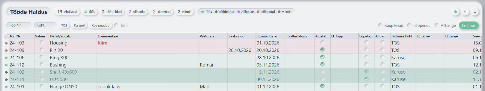

# Tööde Haldus (Job Management)

A soft neumorphic (soft UI) job management app — replaces Excel spreadsheets with an intuitive web interface. Built with vanilla HTML, CSS, and JavaScript. No dependencies, no build step.



## Current version — 0.3.9

0.3.9 makes collaboration recover instead of freezing. A tab with an unresolved conflict keeps refreshing and follows the shared file, conflicting rows are marked in the table, and a failed save retries on its own instead of waiting for a click. Backup snapshots are now filed by month, and `error.log` timestamps use local time with an explicit UTC offset. 0.3.8 fixed the shared-drive lock that could block every user's saves: a lock directory the share refused to recreate is now inspected, a stale lock is reclaimed by renaming it aside, and the lock owner refreshes a heartbeat so a slow but live save is never broken into. See [release notes](CHANGELOG.md).

## Features

- **20 columns** for tracking jobs from start to finish
- **Inline editing** — click any cell to edit
- **Auto-date** — marking a job started or done fills the matching date
- **Status indicators & row tinting** — in progress / subcontract / overdue / done
- **Filters** — by job number and location, show completed or subcontract work
- **CSV import/export** and **automatic backups** (validated snapshot every 48 hours, newest 36 kept, filed by month)
- **Text formatting** — bold (`**`), important (`!!`), strikethrough (`~~`)
- **Undo, duplicate row, sorting, column resize and font size**
- **Light & dark theme** with a soft neumorphic look
- **Conflict handling** — field-level merges, visible conflicted rows and a merge editor for comments
- **Connection diagnostics** — `error.log` next to the executable, plus an explicit "data unavailable" panel in the page

## Keyboard shortcuts

| Key | Action |
| --- | --- |
| `Space` | Toggle the focused checkbox |
| `Enter` | Save the edit |
| `Esc` | Cancel / close |
| `Ctrl+;` | Insert today's date |
| `DD.MM` then `Enter` | Auto-complete the year (e.g. `20.05` → `20.05.2026`) |
| `Ctrl+B` | Bold |
| `Ctrl+I` | Mark as important (red) |
| `Ctrl+Shift+S` | Strikethrough |
| `Ctrl+Z` | Undo |
| `Ctrl+D` | Duplicate the focused or hovered row |

## How to run

1. **Locally:** open `jobs-app/server/web/index.html` in Chrome or Edge.
2. **Windows executable (shared folder):** copy `jobs-app.exe` to a shared network folder and point every shortcut at the same data file:

   ```text
   "K:\your-folder\jobs-app.exe" --data "K:\your-folder\jobs_data.json"
   ```

3. **Build the executable:** from `jobs-app/server`, run `deno task build` with **Deno 2.9.6** — the fixed release toolchain for every version (2.9.7 builds are quarantined by WithSecure). Release builds and the Windows CI workflow both use it.

## Shared folder

- Every user runs the same current version against the same `jobs_data.json`.
- Changes are merged field by field under an exclusive lock, so two people can edit different rows or different fields of the same row at the same time.
- The lock is a directory next to the data file. A lock stranded by a crash is reclaimed automatically after two minutes; a live save keeps refreshing its heartbeat.
- Same-field edits from stale copies are shown as conflicts instead of silently overwriting either value.
- While the shared file cannot be read, the page says so and retries every two seconds instead of showing an empty table.

## Backups

A validated snapshot is written to `backups/<YYYY-MM>/` when the newest valid backup is at least 48 hours old. The newest 36 snapshots are kept across all months; older ones are pruned. To restore, copy one snapshot over `jobs_data.json` while nobody has the app open.

## Diagnostics

`error.log` is written next to the executable (1 MB rotation to `error.log.1`) and records startup/shutdown, tab lifecycle, shared-lock waits and reclaims, merge/load failures, and browser-reported connection and conflict events. `JOBS_LOG_FILE` overrides the path. Timestamps are local time with the UTC offset, and the startup line records the offset and host name.

## Tests

From `jobs-app/server`: `deno task test` (needs Deno 2 and Chromium or Google Chrome). See `tests/README.md` for details.
